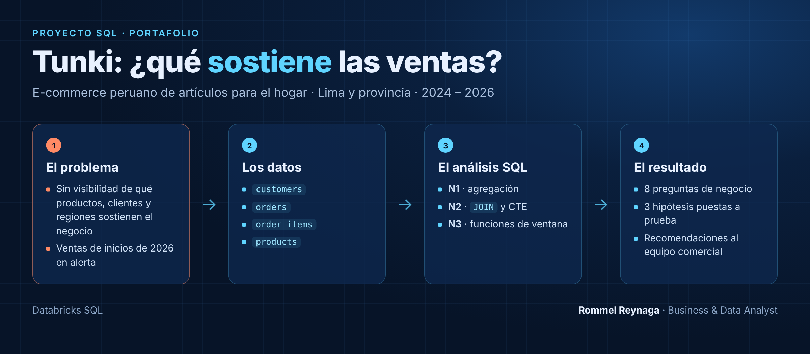
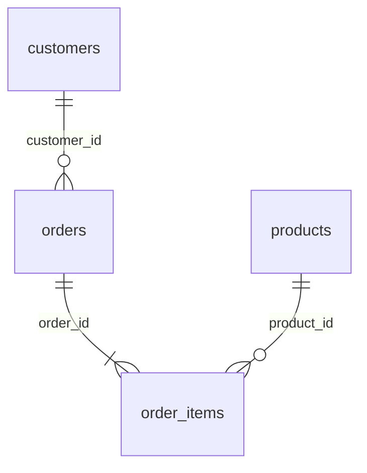
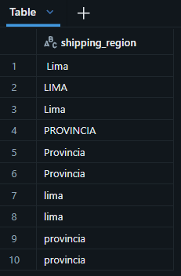

 
# 🛒 Análisis de Ventas del E-commerce Tunki — SQL en Databricks, Limpieza y Funciones de Ventana
 
**Las ventas de enero 2026 cayeron 9,4 % frente a enero 2025, después de 12 meses seguidos de crecimiento. La explicación fácil era la estacionalidad, y no lo era.** Este es el proyecto SQL que separó la caída por región, rango de monto y tarifa de envío, hasta ubicarla en provincia, justo cuando cambió su política de envío.
 
`SQL` · `Databricks SQL` · `CTEs` · `Funciones de ventana`
 
E-commerce de artículos para el hogar · Lima y provincia · Enero 2024 – Febrero 2026 · **39.331 pedidos** · 4 tablas CSV · 137.231 registros crudos · *caso de práctica con datos sintéticos*
 

 
## 📩 Conéctate conmigo
 
¿Tienes ventas que cayeron y nadie sabe por qué, o datos repartidos en varias tablas que nadie se anima a cruzar? Eso es lo que resuelvo: limpiar el dato, hacerle la pregunta correcta en SQL y dejar una recomendación accionable.
 
<p align="center">
  <a href="https://www.linkedin.com/in/rommel-aar%C3%B3n-reynaga-alvarado-470299222/">
    
  </a>
</p>

## 🗂️ Estructura del Proyecto
 
1. [🎯 El problema y las hipótesis](#-1-el-problema-y-las-hipótesis)
2. [🔧 Los datos: fuente, carga y limpieza](#-2-los-datos-fuente-carga-y-limpieza)
3. [🔍 El análisis: preguntas del equipo comercial](#-3-el-análisis-preguntas-del-equipo-comercial)
4. [💡 Conclusión y recomendación](#-4-conclusión-y-recomendación)
5. [⚠️ Alcance y limitaciones](#-5-alcance-y-limitaciones)
---
 
## 🎯 1. El problema y las hipótesis
 
### El negocio
 
**Tunki** es un e-commerce peruano de artículos para el hogar. Vende 400 productos en 7 categorías —decoración, menaje, textiles, organización, iluminación, muebles y pequeños electrodomésticos de cocina— a clientes de Lima y de provincia, que llegan por tres canales: orgánico, pauta digital y referidos.
 
Gana dinero con el margen entre el precio de venta y el costo del producto. A ese margen le descuenta dos costos por pedido: el **envío**, que le cuesta más de lo que le cobra al cliente, y la **comisión del medio de pago**.
 
### El problema
 
> *"Enero arrancó mal y no sabemos por qué."* — Gerente comercial
 
El gerente comercial y sus supervisores de venta siguen el negocio desde la operación: las campañas, el catálogo, lo que reportan sus equipos. Ven que enero vendió menos, pero no miran las transacciones que guarda el sistema, así que no saben **dónde** cayó la venta ni **por qué**.
 
### La magnitud
 
Enero 2026 vendió **S/ 140,1 mil**, frente a S/ 154,6 mil en enero 2025: **−9,4 %, S/ 14,5 mil menos**.
 
No es un mal mes cualquiera: durante los 12 meses anteriores, cada mes había vendido entre 9,3 % y 25 % más que el mismo mes del año anterior. Enero 2026 es el primero que vende menos.
 
### El objetivo
 
**Del negocio:** que desde marzo 2026 cada mes vuelva a vender más que el mismo mes del año anterior.
 
**Del análisis:** encontrar con los datos dónde se concentra la caída —de lo general a lo particular: período, categoría, producto, región— y qué la explica, para que el equipo comercial sepa sobre qué actuar.
 
### Las hipótesis
 
| # | Hipótesis | Qué la daría por falsa |
|---|---|---|
| H1 | La caída es estacional: enero siempre vende menos que diciembre | Que enero 2026 también caiga frente a enero 2025 |
| H2 | La caída se concentra en algunas categorías o productos | Que todas las categorías caigan en una proporción parecida |
| H3 | La caída se concentra en una región | Que Lima y provincia caigan en una proporción parecida |
 
---

## 🔧 2. Los datos: fuente, carga y limpieza
 
### La fuente
 
Cuatro archivos CSV de un **dataset sintético generado con IA**, que simula el sistema de ventas de Tunki. Como no contiene información de ninguna empresa real, se publica completo en [`Data/`](Data/).
 
| Tabla | Qué registra | Filas × columnas | Grano | Aporta |
|---|---|---|---|---|
| `customers` | Clientes registrados | 22.482 × 5 | Un cliente | Región, ciudad, canal de adquisición, fecha de registro |
| `orders` | Cabecera de pedidos | 39.528 × 10 | Un pedido | Fecha, estado, monto, costo, envío cobrado y costo real del envío |
| `order_items` | Detalle de pedidos | 74.821 × 6 | Una línea de pedido | Producto, cantidad, precio y costo de cada venta |
| `products` | Catálogo de productos | 400 × 5 | Un producto | Nombre, categoría, precio y costo |
 

 
### La carga
 
Subí los cuatro CSV a Databricks (`bd_e_commerce_tunki.default`) con la carga de archivos, que crea cada tabla e infiere el tipo de cada columna. **No hay `INSERT INTO`, porque las filas vienen en el archivo.** El [`01_DDL.sql`](Scripts/01_DDL.sql) documenta la estructura resultante.
 
**Control de carga:** las cuatro tablas tienen en Databricks las mismas filas que su CSV.
 
### La limpieza
 
Pasé las tablas por cuatro controles de calidad. Cada problema que encontré sigue el mismo recorrido: **detectarlo**, **corregirlo** creando una tabla nueva (las originales no se tocan) y **verificar** que la corrección funcionó.
 
| Etapa | Control | Tabla | SQL utilizado | Resultado |
|---|---|---|---|---|
| **Detección** | Valores nulos | `customers` | `count_if(... IS NULL)` | 435 clientes sin `city` |
| **Detección** | Duplicados | `orders` | `COUNT(*)` · `COUNT(DISTINCT)` · `SELECT DISTINCT *` | 197 pedidos repetidos, copias exactas |
| **Detección** | Texto inconsistente | `customers` | `SELECT DISTINCT shipping_region` | 10 formas de escribir 2 regiones |
| **Detección** | Rango de fechas | `orders` | `MIN` · `MAX` · `date_format` | Del 01-01-2024 al 12-02-2026; febrero 2026 solo tiene 12 días |
| **Limpieza** | Valores nulos | `customers` → `customers_clean` | `COALESCE(city, 'Sin dato')` | Los nulos pasan a "Sin dato" |
| **Limpieza** | Duplicados | `orders` → `orders_clean` | `CREATE TABLE AS SELECT DISTINCT *` | Se eliminan las 197 copias |
| **Limpieza** | Texto inconsistente | `customers` → `customers_clean` | `LOWER(TRIM(shipping_region))` | Las 10 variantes quedan en 2 |
| **Limpieza** | Rango de fechas | — | No se borra | Febrero 2026 se excluye de las comparaciones mensuales |
| **Verificación** | Valores nulos | `customers_clean` | `count_if(city IS NULL)` | 0 nulos |
| **Verificación** | Duplicados | `orders_clean` | `COUNT(*)` vs `COUNT(DISTINCT order_id)` · `SUM` vs `order_items` | 39.331 = 39.331, y el monto cuadra con el detalle: se quitaron S/ 29.758,91 contados dos veces |
| **Verificación** | Texto inconsistente | `customers_clean` | `GROUP BY shipping_region` | Lima 12.699 + provincia 9.783 = 22.482 clientes |
 
#### Detección
 
```sql
-- 1 · Valores nulos (se revisaron las 4 tablas; solo customers.city tiene)
SELECT COUNT(*) AS filas, 
        count_if(city IS NULL) AS nulos_city
FROM customers;                                          
-- 22.482 · 435
 
-- 2 · Duplicados: ¿cuántas filas, cuántos pedidos y cuántas filas distintas?
SELECT
  (SELECT COUNT(*) FROM orders)                          AS filas,
  (SELECT COUNT(DISTINCT order_id) FROM orders)          AS pedidos_unicos,
  (SELECT COUNT(*) FROM (SELECT DISTINCT * FROM orders)) AS filas_distintas;
-- 39.528 · 39.331 · 39.331
 
-- 3 · Texto inconsistente
SELECT DISTINCT shipping_region
FROM customers
ORDER BY shipping_region;                                
-- 10 variantes
 
-- 4 · Rango de fechas y días por mes
SELECT
  date_format(order_datetime, 'yyyy-MM')  AS mes,
  COUNT(DISTINCT DATE(order_datetime))    AS dias_con_pedidos
FROM orders
GROUP BY mes
ORDER BY mes;                                              
-- feb-2026: 12 días
```
 
Que las filas distintas (39.331) sean iguales a los pedidos únicos prueba que los duplicados son **copias exactas**: por eso alcanza con `SELECT DISTINCT *`.
 

 
El código de la limpieza y de la verificación, con el resultado de cada consulta, está en [`Scripts/02_limpieza.sql`](Scripts/02_limpieza.sql).
 
### Las reglas para el análisis
 
- Usar `orders_clean` y `customers_clean`; `order_items` y `products`, tal cual.
- Para comparar regiones, usar `shipping_region`: `city` tiene clientes "Sin dato".
- Excluir febrero 2026 de las comparaciones mensuales.
- Redondear solo el resultado final: `ROUND(SUM(...), 2)`, nunca antes de sumar.
---
 
## 🔍 3. El análisis: preguntas del equipo comercial
 
**Definición de venta:** pedidos con estado `COMPLETED`, medidos con `merchandise_value` (valor de los productos, sin envío). Febrero 2026 se excluye por estar incompleto.
 
Las preguntas van de lo general a lo particular: primero se mide el fenómeno, después se pone a prueba cada hipótesis.
 
1. **¿Cómo evolucionan las ventas, los pedidos y el ticket promedio cada mes?** · Gerente comercial · *mide el fenómeno*
2. **¿Cómo crece cada mes frente al mismo mes del año anterior?** · Gerente comercial · *H1*
3. **¿Subieron las cancelaciones o devoluciones en enero 2026?** · Gerente comercial · *descarta una causa operativa*
4. **¿Cuánto vendió cada categoría en enero 2026 frente a enero 2025?** · Supervisores · *H2*
5. **¿Qué productos perdieron más ventas entre enero 2025 y enero 2026?** · Supervisores · *H2*
6. **¿En qué región y en qué rango de monto de pedido cayó enero 2026?** · Supervisores · *H3*
7. **¿Qué cambió en esa región entre 2025 y enero 2026?** · Gerente comercial · *busca la causa*
⏳ *Cada pregunta se desarrolla aquí con su consulta, su resultado y su hallazgo.*